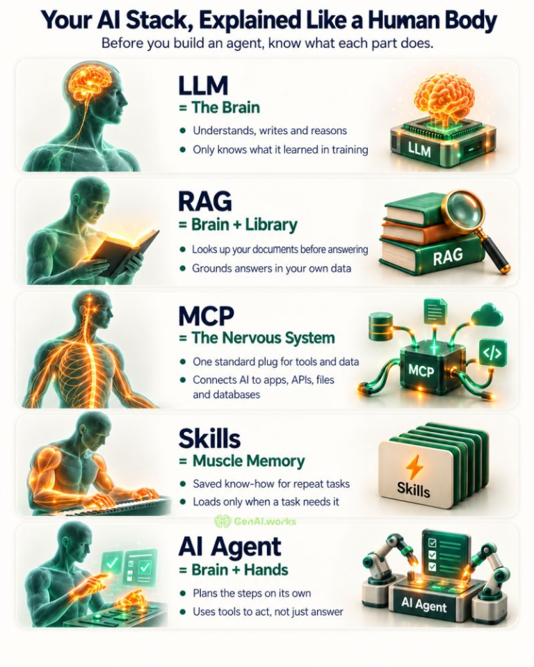
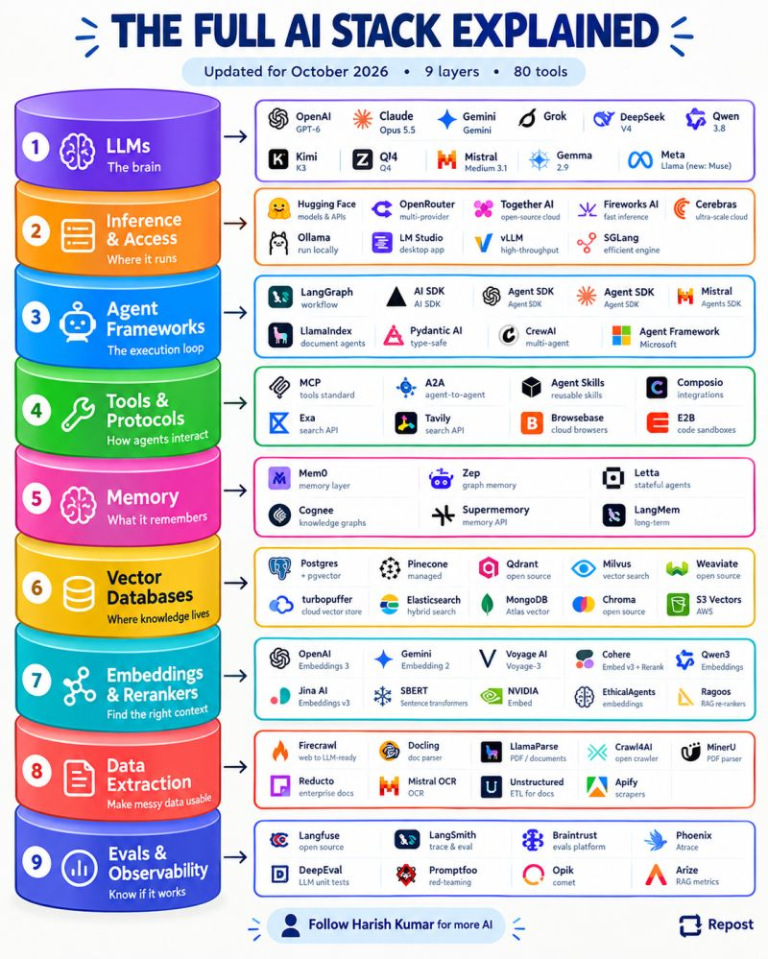

# Azure AI and Data Certification Study Hub

Personal study notes, projects, practice questions, and preparation resources.

## Certification Index

| Certification | Focus | Status | Start here |
| --- | --- | --- | --- |
| [AI-103](#ai-103) | Azure AI apps and agents | Certification completed; materials available | [Learning paths](#ai-103-course-structure) and [practice papers](#ai-103-full-length-practice-test-papers) |
| [DP-420](#dp-420) | Azure Cosmos DB and AI applications | **WIP** | [Enrollment and study guide](./DP-420/notes/dp-420-study-guide.md) |
| [DP-600](#dp-600) | Microsoft Fabric analytics | **WIP** | [Study guide and resources](./DP-600/notes/dp-600-study-guide.md) |
| [DP-700](#dp-700) | Microsoft Fabric data engineering | **WIP** | [Study guide and resources](./DP-700/notes/dp-700-study-guide.md) |

Each certification has its own section below. [Shared resources](#shared-resources) apply across certifications.
WIP collections are incomplete and under active development.

## AI-103

**Microsoft Certified: Azure AI Apps and Agents Developer Associate**

> **My recommendation: AI-103 is a must-have certification for data and AI engineers working with Azure.** It broadens understanding of Azure AI services and helps inform architecture decisions for AI apps and agents. This is my recommendation, not an official requirement for these roles.

**Status:** Certification completed; notes, projects, and practice materials available.
The four numbered learning-path folders, [key learnings](./key%20learnings/key-learnings.md), and [test papers](./test-papers/) belong to AI-103.

[Official AI-103 certification](https://learn.microsoft.com/en-us/credentials/certifications/azure-ai-apps-and-agents-developer-associate/?practice-assessment-type=certification)

**Pass exam (score ≥700) + build production-grade AI agent skills**

### Why I Chose AI-103

I've been using Microsoft Foundry (formerly Azure AI Foundry),the Azure Cosmos DB toolkit, and Foundry IQ (Azure AI Search) to build agents. I chose this certification to broaden my understanding of Azure AI services, discover features I haven't explored, and make better architectural decisions when building code-first AI solutions..

### My AI-103 Study Approach

I'll work through the official Microsoft Learn content to solidify my understanding, build small projects where needed, and test my knowledge with the practice questions in this repo. I'll keep the content concise and relevant.

### AI-103 Course Structure

The AI-103 course has **4 learning paths** with **34 modules total**:

| Official Learning Path | My Learnings | Practice Questions | Weight | My Priority (1–5) |
|------------------------|--------------|--------------------|--------|-------------------|
| [1. Develop generative AI apps in Azure](https://learn.microsoft.com/en-us/training/paths/develop-generative-ai-apps/) | [Notes and projects](./1.%20Develop%20generative%20AI%20apps%20in%20Azure/) | [Question bank](./1.%20Develop%20generative%20AI%20apps%20in%20Azure/questions/) | 30–35% | **5/5 — Core focus** |
| [2. Develop AI agents on Azure](https://learn.microsoft.com/en-us/training/paths/develop-ai-agents-azure/) | [Notes and projects](./2.%20Develop%20AI%20agents%20on%20Azure/) | [Question bank](https://github.com/psingla/Microsoft-Azure-AI-103-Certification/tree/main/2.%20Develop%20AI%20agents%20on%20Azure/questions) | 30–35% | **5/5 — Core focus** |
| [3. Develop natural language solutions in Azure](https://learn.microsoft.com/en-us/training/paths/develop-language-solutions-azure-ai/) | [Notes and projects](https://github.com/psingla/Microsoft-Azure-AI-103-Certification/tree/main/3.%20Develop%20natural%20language%20solutions%20in%20Azure) | [Question bank](https://github.com/psingla/Microsoft-Azure-AI-103-Certification/tree/main/3.%20Develop%20natural%20language%20solutions%20in%20Azure/questions) | 10–15% | **3/5 — Supporting knowledge** |
| [4. Extract insights from visual data on Azure](https://learn.microsoft.com/en-us/training/paths/insight-visual-data/) | [Notes and projects](https://github.com/psingla/Microsoft-Azure-AI-103-Certification/tree/main/4.%20Extract%20insights%20from%20visual%20data%20on%20Azure) | [Question bank](https://github.com/psingla/Microsoft-Azure-AI-103-Certification/tree/main/4.%20Extract%20insights%20from%20visual%20data%20on%20Azure/questions) | 20–30% | **3/5 — Supporting knowledge** |

*My Priority reflects my current learning focus, not exam weight: 1 = lowest, 5 = highest. Ratings can change as I progress.*

My notes, projects, and topic-specific question banks cover all four learning paths, with paths 1 and 2 remaining my core focus. This is a personal study choice, not a claim that the supporting paths are unimportant for the exam.

### AI-103 Key Learnings

[Key learnings: Generative AI and Agents](./key%20learnings/key-learnings.md) collects takeaways from studying AI-103. The current key learnings belong to AI-103, not DP-420, DP-600, or DP-700.

### AI-103 Full-Length Practice Test Papers

**All current test papers and practice question banks in this repository are for AI-103 only, not DP-420, DP-600, or DP-700.**

[Full-length case-based question papers](./test-papers/) cover topics across AI-103.

- [60-question full practice test](./test-papers/ai-103-full-practice-test.html): 45 standalone scenarios, 8 direct questions, and one final case study with 7 questions. Includes hidden answers and explanations.
- [60-question focused practice paper](./test-papers/ai-103-ocr-search-evaluation-practice-test.html): OCR, evaluation, Azure AI Search, built-in skills and agent tools/function calling, and OpenAI endpoints. Mostly scenarios, with one final 7-question case study and explained answers.

**The AI-103 practice questions in this repository are AI-generated**, not official Microsoft exam questions. They may contain errors; verify answers against current Microsoft Learn documentation.

### 🎓 My AI-103 Certification Reflections

[Completing AI-103](https://learn.microsoft.com/en-us/users/pramodsingla-8568/credentials/certification/azure-ai-apps-and-agents-developer-associate?tab=credentials-tab) improved my understanding of the Microsoft services available for building AI agents. I do not use all of them in my day-to-day work, but learning about them gave me more options to consider before implementing custom solutions and filled several gaps in my knowledge.

Some exam content—particularly memorizing code syntax and learning about services less relevant to my work—felt less useful. Overall, however, it was a valuable learning experience. My next step is to build a project based on this new understanding so I can reinforce what I learned through practice.

The [official Microsoft certification resources](https://learn.microsoft.com/en-us/credentials/certifications/azure-ai-apps-and-agents-developer-associate/?practice-assessment-type=certification) are a good place to study. I recommend reviewing the architecture diagrams and key concepts, then completing hands-on exercises like the sample projects in this repository. The notes here are personal to my learning needs, and the AI-generated practice questions may be useful, but their accuracy and relevance are not guaranteed.

## DP-420

**Microsoft Certified: Azure Cosmos DB AI Developer Associate**

**Status: WIP** — study notes and resources are being added.

**Why I'm studying it:** Deepen my Cosmos DB knowledge to understand where custom
Cosmos DB-based agent memory fits alongside Foundry Agent Service's managed
Memory capability and retrieval-based approaches, and understand the Cosmos DB
toolkit better. Custom memory and retrieval can work together.

- [DP-420 collection](./DP-420/)
- [Enrollment, motivation, and study guide](./DP-420/notes/dp-420-study-guide.md)
- [Official certification and exam booking](https://learn.microsoft.com/en-us/credentials/certifications/azure-cosmos-db-developer-specialty/?practice-assessment-type=certification)

## DP-600

**Implementing Analytics Solutions Using Microsoft Fabric**

**Status: WIP** — study notes and resources are being added.

This collection covers preparation for DP-600, focused on Microsoft Fabric analytics.

- [DP-600 collection](./DP-600/)
- [Study plan, resources, and voucher caveats](./DP-600/notes/dp-600-study-guide.md)
- [Official study guide](https://learn.microsoft.com/en-us/credentials/certifications/resources/study-guides/dp-600)

## DP-700

**Implementing Data Engineering Solutions Using Microsoft Fabric**

**Status: WIP** — study notes and resources are being added.

This collection covers preparation for DP-700, focused on Microsoft Fabric data engineering.

- [DP-700 collection](./DP-700/)
- [Study plan, resources, and exam-day tips](./DP-700/notes/dp-700-study-guide.md)
- [Official study guide](https://learn.microsoft.com/en-us/credentials/certifications/resources/study-guides/dp-700)

## Shared Resources

### The AI Stack

These concepts apply across AI platforms, not just Azure or a single certification.

*Infographic credit: GenAI.works.*

#### The Full AI Stack

*Infographic credit: Harish Kumar, as shown in the supplied image. This is a third-party overview, not an official Microsoft architecture or certification guide; verify tool and model details against current documentation.*

---

*Last updated: 2026-10-16*
